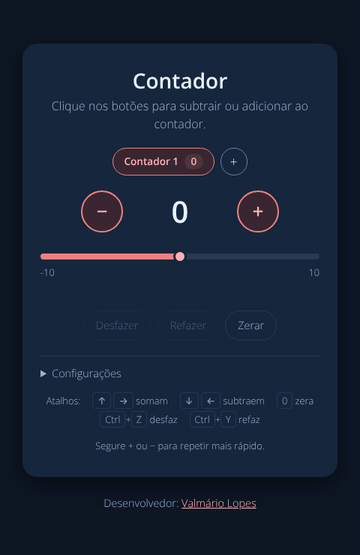
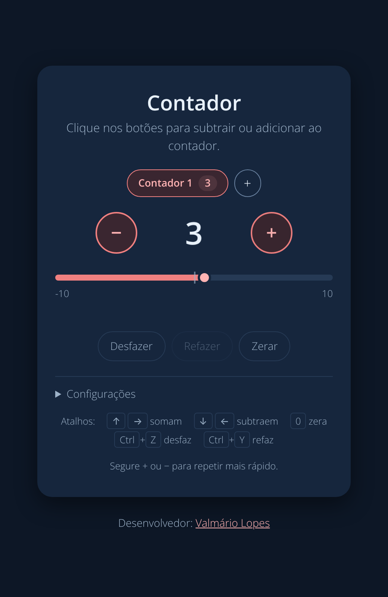
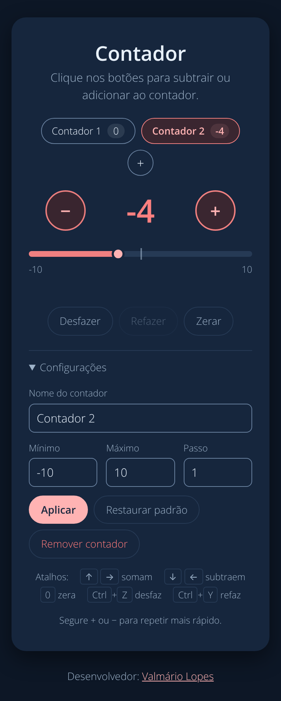

# Contador de Números

[](https://github.com/Valmario/Contador_Projeto_DIO/actions/workflows/ci.yml)
[](LICENSE)


Contador feito com **TypeScript e Vite**, sem frameworks. Nasceu como projeto da aula _Introdução ao JavaScript_ da [DIO](https://www.dio.me/) e foi evoluído com práticas de projeto profissional: lógica separada e testada, acessibilidade verificada automaticamente, tema claro/escuro, modo offline e integração contínua.

<p align="center">
  
</p>

**Demo:** <https://valmario.github.io/Contador_Projeto_DIO/>

<p align="center">
  
  
</p>

## Funcionalidades

- Soma e subtrai dentro de um intervalo (padrão **-10 a 10**), com **botões desabilitados** nos limites e aviso na tela
- Número em **vermelho** quando negativo
- **Desfazer e refazer** (até 100 ações por contador)
- **Vários contadores** (até 8), cada um com valor e histórico próprios
- **Limites e passo configuráveis**, pela tela ou pela URL: `?min=0&max=100&step=5`
- **Segurar o botão** repete a ação, acelerando aos poucos (para sozinho no limite)
- **Atalhos de teclado:** `↑` `→` somam · `↓` `←` subtraem · `0` zera · `Ctrl+Z` desfaz · `Ctrl+Y` refaz
- **Memória:** o estado é salvo no navegador e restaurado ao reabrir (com migração do formato da versão 1)
- **Instalável e offline:** PWA com service worker
- **Tema claro e escuro** automático e respeito a `prefers-reduced-motion`

## Como rodar

Precisa do [Node.js](https://nodejs.org/) 22.12 ou mais novo.

```bash
npm install
npm run dev        # servidor de desenvolvimento em http://localhost:5173
```

| Comando                 | O que faz                                                        |
| ----------------------- | ---------------------------------------------------------------- |
| `npm run dev`           | Servidor de desenvolvimento com recarga automática               |
| `npm run build`         | Checa os tipos e gera a versão de produção em `dist/`            |
| `npm run preview`       | Serve o `dist/` localmente                                       |
| `npm test`              | Testes unitários e de integração (Vitest)                        |
| `npm run test:coverage` | Os mesmos testes, com relatório de cobertura                     |
| `npm run test:e2e`      | Testes de ponta a ponta em navegador real (Playwright)           |
| `npm run lint`          | ESLint com regras de TypeScript que usam informação de tipos     |
| `npm run format`        | Formata o código com o Prettier                                  |
| `npm run check`         | Lint, formatação, tipos e testes de uma vez (rode antes do push) |
| `npm run screenshots`   | Gera as imagens e o GIF de `docs/` (precisa do `build` e ffmpeg) |

Na primeira vez que rodar os testes de ponta a ponta, instale o navegador: `npx playwright install chromium`.

## Qualidade

- **105 testes unitários e de integração**, com 100% das linhas cobertas no núcleo e na interface. A página real (`index.html`) é carregada no jsdom e usada como um usuário usaria.
- **24 testes de ponta a ponta** em Chrome: limites, teclado, segurar para repetir, persistência, URL, offline, tela de celular.
- **Acessibilidade com o axe** nos temas claro e escuro, inclusive no estado de limite.
- **Lighthouse 100 / 100 / 100 / 100** (desempenho, acessibilidade, boas práticas, SEO), com deslocamento de layout (CLS) 0. O CI reprova se as notas caírem abaixo de 90 (95 em acessibilidade) ou se o CLS passar de 0,05.
- **TypeScript no modo estrito**, incluindo `noUncheckedIndexedAccess`.
- **Tamanho:** 11,5 kB de JavaScript (4,6 kB comprimido) e nenhuma dependência em tempo de execução.

O CI (`.github/workflows/ci.yml`) roda lint, formatação, tipos, testes com cobertura, build, testes de ponta a ponta e Lighthouse a cada push e pull request. O Dependabot mantém as dependências atualizadas.

## Estrutura

```
├── index.html
├── public/                   # copiado como está para o build
│   ├── sw.js                 # service worker (offline)
│   ├── manifest.webmanifest
│   ├── fonts/                # Open Sans (licença OFL incluída)
│   └── icon*.png|svg
├── src/
│   ├── core/                 # regras, sem DOM
│   │   ├── counter.ts        # contador: limites, passo, desfazer/refazer
│   │   ├── store.ts          # vários contadores e configuração compartilhada
│   │   ├── config.ts         # leitura e escrita dos parâmetros da URL
│   │   └── storage.ts        # persistência validada, com migração v1 → v2
│   ├── ui/
│   │   ├── holdRepeat.ts     # segurar o botão para repetir
│   │   └── shortcuts.ts      # atalhos de teclado
│   ├── app.ts                # liga as regras à página
│   ├── main.ts, pwa.ts, styles.css
├── tests/
│   ├── unit/                 # Vitest (+ jsdom)
│   └── e2e/                  # Playwright (+ axe)
├── scripts/screenshots.mjs
└── .github/                  # CI, publicação, release, Dependabot
```

## Decisões técnicas

- **Regras separadas da interface.** `core/` não conhece o DOM, então é testado direto e poderia ser reaproveitado em outra interface. O `app.ts` só traduz o estado em tela.
- **O estado é a fonte da verdade.** Na primeira versão, só a _exibição_ era limitada e o contador interno passava de 10: depois de 12 cliques em `+`, um clique em `-` mostrava 11. Agora o valor é limitado no próprio estado, com teste de regressão.
- **Persistência defensiva.** O que vem do `localStorage` é validado antes de usar; dado corrompido ou fora do intervalo é descartado, e quem usava a versão 1 não perde o valor.
- **Offline sem surpresas.** O service worker usa a URL como chave do cache e ignora o `Vary`. Foi um erro real, encontrado pelo teste de ponta a ponta: o servidor respondia `Vary: Origin` e o navegador não achava no cache os scripts que ele mesmo tinha guardado.
- **Sem pulos de layout.** A fonte vem do próprio site, é pré-carregada e usa `font-display: optional`; a altura de linha é explícita e os espaços são reservados antes do JavaScript rodar. O CLS caiu de 0,26 para 0.
- **Acessibilidade medida, não presumida.** O axe encontrou texto com contraste abaixo do mínimo (4,31:1 no rodapé e 3,9:1 em uma etiqueta); os dois foram corrigidos.

## Publicação

**GitHub Pages** (uma vez): _Settings → Pages → Build and deployment → Source: **GitHub Actions**_. Depois disso, cada push na `main` publica o site automaticamente (`.github/workflows/pages.yml`).

**Release:** `git tag v2.0.0 && git push origin v2.0.0` cria a release com notas geradas automaticamente. Ao publicar uma versão nova do app, mude `CACHE_VERSION` em `public/sw.js` para os navegadores descartarem o cache antigo.

## Desafios da aula

- [x] Usar `addEventListener` nos eventos
- [x] Desabilitar os botões ao chegar nos limites (`-10 <= count <= 10`)
- [x] Texto vermelho quando o número for negativo

## Créditos

Projeto da aula de _Introdução ao JavaScript_ da [DIO](https://www.dio.me/), ministrada por [@stebsnusch](https://github.com/stebsnusch). A fonte [Open Sans](https://github.com/googlefonts/opensans) é distribuída sob a [SIL Open Font License 1.1](public/fonts/OFL-LICENSE.txt).

## Autor

**Valmário Lopes** · [GitHub](https://github.com/Valmario) · [LinkedIn](https://linkedin.com/in/valmariolopes)

## Licença

[MIT](LICENSE)
